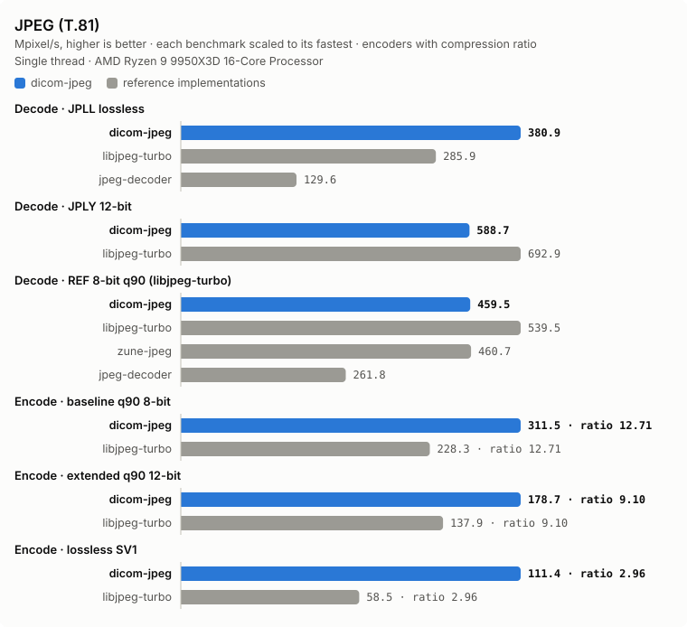
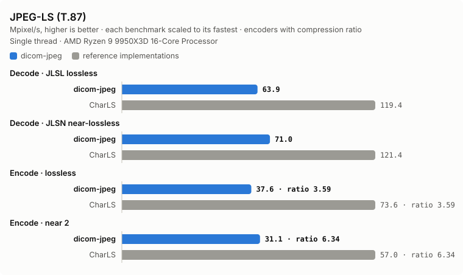
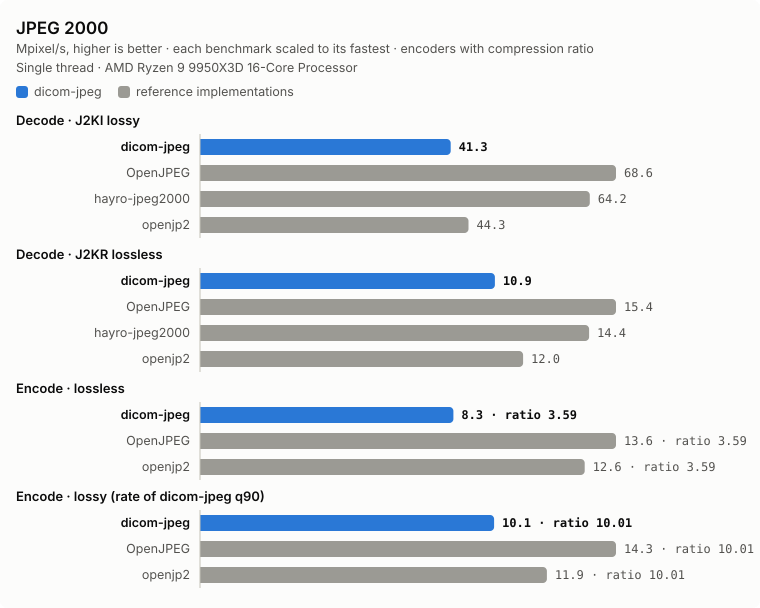
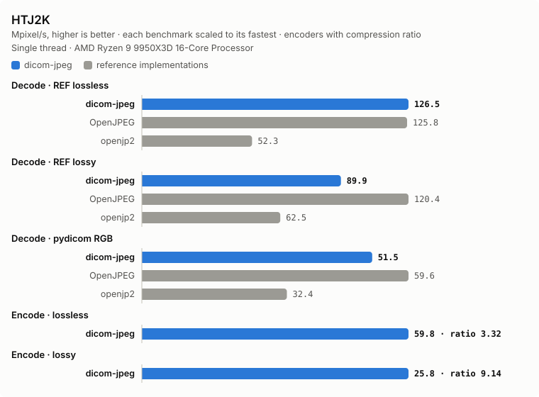
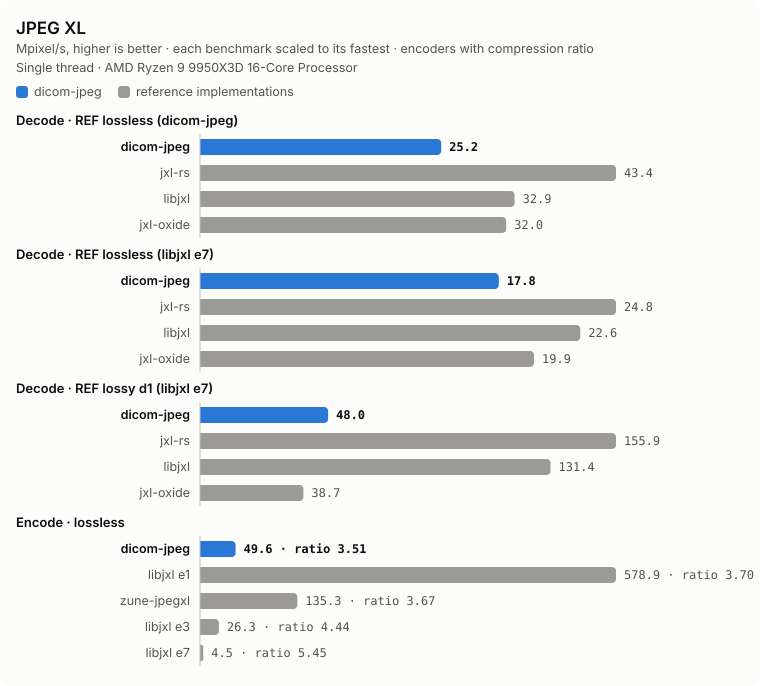

# dicom-jpeg

Pure-Rust encoders and decoders for every active JPEG-family DICOM transfer syntax.
Each codec sits behind its own cargo feature.

| Transfer syntax UID (1.2.840.10008.1.2.4.x) | Codec | Feature | Status |
|---|---|---|---|
| .50 .51 .57 .70 | JPEG baseline / extended / lossless (T.81) | `jpeg` | decoder ✔ encoder ✔ |
| .80 .81 | JPEG-LS (T.87) | `jpeg-ls` | decoder ✔ encoder ✔ |
| .90 .91 | JPEG 2000 (15444-1) | `jpeg2000` | decoder ✔ encoder ✔ |
| .92 .93 | JPEG 2000 Part 2 multi-component | `jpeg2000-part2` | decoder ✔ encoder ✔ |
| .201 .202 .203 | HTJ2K (15444-15) | `htj2k` | decoder ✔ encoder ✔ |
| .110 .111 .112 | JPEG XL (18181) | `jpeg-xl` | decoder: modular and VarDCT (sRGB, no ICC, no patches/noise/splines/blending); encoder: lossless |

Other features:

* `encode`: enables the encoders.
* `dicom`: dicom-rs `PixelDataReader` / `PixelDataWriter` adapters (`dicom_jpeg::dicom_rs::PixelAdapter`, crate `dicom-jpeg-dicom`).
* `inventory-registry`: also register the adapters in the dicom-rs transfer syntax registry (see below).

## Using it with dicom-rs

With the `inventory-registry` feature, dicom-jpeg registers itself as the
dicom-rs codec for the JPEG family, so dicom-rs decodes, encodes and
transcodes these transfer syntaxes with it (e.g. `decode_pixel_data`,
`Transcode`) without code changes:

```toml
[dependencies]
dicom = "0.10"
dicom-jpeg = { git = "https://github.com/feliwir/dicom-jpeg", features = ["inventory-registry"] }
```

The guide in [crates/dicom/README.md](crates/dicom/README.md) explains:
- linking the crate;
- which transfer syntaxes dicom-jpeg takes over from dicom-rs's built-in
  codecs (all but JPEG baseline unless dicom-pixeldata's `native` feature is
  off);
- using the adapter directly.

The example [crates/dicom-jpeg/examples/dicom_rs.rs](crates/dicom-jpeg/examples/dicom_rs.rs)
converts DICOM files to PNG with plain dicom-rs:

```sh
cargo run --release -p dicom-jpeg --example dicom_rs --features inventory-registry -- testdata/dicom/wg04/J2KR/CT1_J2KR --window 40 400
```

## Crates

The repository is a virtual cargo workspace. `crates/dicom-jpeg` is the
facade: it re-exports the crates below behind the features above (the
adapter as `dicom_jpeg::dicom_rs`) and dispatches decoding by `Codec`. It
also holds the integration tests, fuzz targets and test data.

| Crate | Contents |
|---|---|
| `crates/common` (`dicom-jpeg-common`) | `Image`, options, limits, errors, `Codec`; canonical Huffman code construction and colour transforms (YCbCr / ICT, RCT) shared by the codecs |
| `crates/jpeg` (`dicom-jpeg-jpeg`) | ITU-T T.81 |
| `crates/jpegls` (`dicom-jpeg-jpegls`) | ITU-T T.87 |
| `crates/j2k` (`dicom-jpeg-j2k`) | JPEG 2000 with the `htj2k` and `part2` features |
| `crates/jxl` (`dicom-jpeg-jxl`) | JPEG XL |
| `crates/dicom` (`dicom-jpeg-dicom`) | dicom-rs `PixelDataReader` / `PixelDataWriter` adapter; maps transfer syntax UIDs (`dicom_dictionary_std::uids`) to a codec and its parameters |

The codec crates know nothing about DICOM; each takes its own
`EncoderOptions` and can be used on its own.

## Testing

Test data is stored with Git LFS. Its provenance is documented in `testdata/SOURCES.md`.

```sh
git lfs pull
cargo test --all-features             # implemented codecs
cargo test --all-features -- --ignored  # cases for codecs that are not implemented yet
```

`crates/dicom-jpeg/tests/dicom_decode.rs` decodes every NEMA WG04, pydicom and pylibjpeg file through the dicom-rs adapter and compares it with the uncompressed reference.
`crates/dicom-jpeg/tests/dicom_roundtrip.rs` encodes native references, writes and re-reads a DICOM file with dicom-rs, then decodes and compares the result.

## Benchmarks

`benchmarks/` holds Criterion benchmarks against reference implementations
that have Rust bindings: libjpeg-turbo, zune-jpeg, jpeg-decoder, CharLS,
OpenJPEG, openjp2, hayro-jpeg2000, libjxl, jxl-oxide, jxl-rs and zune-jpegxl.
They are all single-threaded and run on the WG04 test set. See
[benchmarks/README.md](benchmarks/README.md).

```sh
cargo bench -p dicom-jpeg-benchmarks
```

Results on an AMD Ryzen 9 9950X3D, single-threaded, with dicom-jpeg at its
best SIMD level (AVX-512). Within each benchmark, bars are scaled to the
fastest implementation. The numbers are listed in
[benchmarks/results/README.md](benchmarks/results/README.md), together with
the speed-ups of the [SIMD kernels](benchmarks/results/kernels.svg) over
scalar code.







## License

MIT OR Apache-2.0
