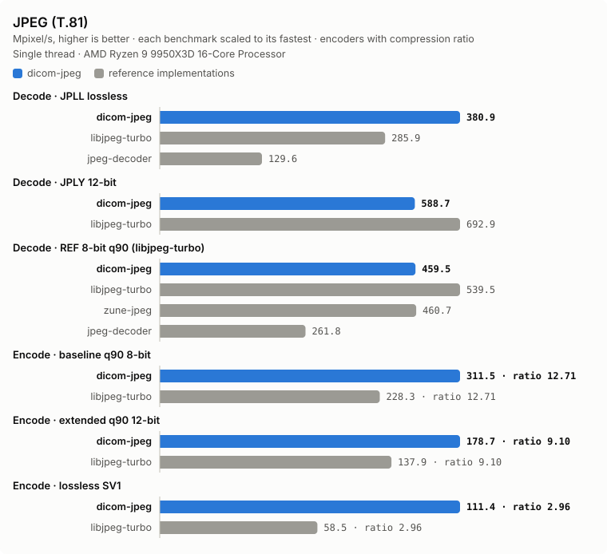
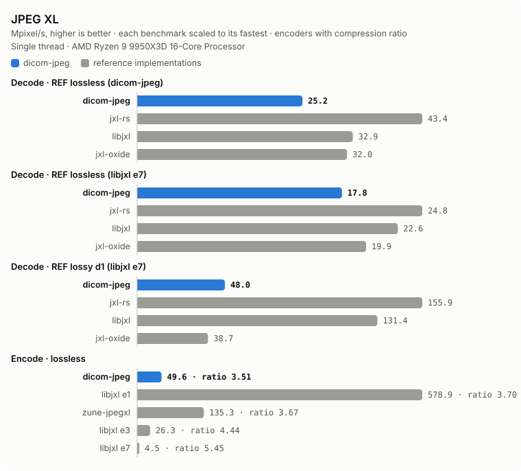

# Benchmark results

Single-threaded throughput on AMD Ryzen 9 9950X3D 16-Core Processor (2026-11-17); dicom-jpeg at the best SIMD level.
Generated by `benchmarks/plot.py` from `cargo bench -p dicom-jpeg-benchmarks`;
see [../README.md](../README.md) for the method and inputs.

## JPEG (T.81)

| Benchmark | Implementation | Mpixel/s | Compression ratio |
|---|---|---|---|
| Decode · JPLL lossless | **dicom-jpeg** | 119.4 |  |
| Decode · JPLL lossless | libjpeg-turbo | 286.8 |  |
| Decode · JPLL lossless | jpeg-decoder | 128.9 |  |
| Decode · JPLY 12-bit | **dicom-jpeg** | 585.1 |  |
| Decode · JPLY 12-bit | libjpeg-turbo | 686.6 |  |
| Decode · REF 8-bit q90 (libjpeg-turbo) | **dicom-jpeg** | 461.2 |  |
| Decode · REF 8-bit q90 (libjpeg-turbo) | libjpeg-turbo | 526.7 |  |
| Decode · REF 8-bit q90 (libjpeg-turbo) | zune-jpeg | 465.0 |  |
| Decode · REF 8-bit q90 (libjpeg-turbo) | jpeg-decoder | 263.2 |  |
| Encode · baseline q90 8-bit | **dicom-jpeg** | 313.6 | 12.71 |
| Encode · baseline q90 8-bit | libjpeg-turbo | 228.2 | 12.71 |
| Encode · extended q90 12-bit | **dicom-jpeg** | 181.1 | 9.10 |
| Encode · extended q90 12-bit | libjpeg-turbo | 137.9 | 9.10 |
| Encode · lossless SV1 | **dicom-jpeg** | 111.2 | 2.96 |
| Encode · lossless SV1 | libjpeg-turbo | 55.6 | 2.96 |

## JPEG-LS (T.87)

| Benchmark | Implementation | Mpixel/s | Compression ratio |
|---|---|---|---|
| Decode · JLSL lossless | **dicom-jpeg** | 63.9 |  |
| Decode · JLSL lossless | CharLS | 119.4 |  |
| Decode · JLSN near-lossless | **dicom-jpeg** | 71.0 |  |
| Decode · JLSN near-lossless | CharLS | 121.4 |  |
| Encode · lossless | **dicom-jpeg** | 37.6 | 3.59 |
| Encode · lossless | CharLS | 73.6 | 3.59 |
| Encode · near 2 | **dicom-jpeg** | 31.1 | 6.34 |
| Encode · near 2 | CharLS | 57.0 | 6.34 |

## JPEG 2000

| Benchmark | Implementation | Mpixel/s | Compression ratio |
|---|---|---|---|
| Decode · J2KI lossy | **dicom-jpeg** | 41.3 |  |
| Decode · J2KI lossy | OpenJPEG | 68.4 |  |
| Decode · J2KI lossy | hayro-jpeg2000 | 62.1 |  |
| Decode · J2KI lossy | openjp2 | 44.4 |  |
| Decode · J2KR lossless | **dicom-jpeg** | 10.8 |  |
| Decode · J2KR lossless | OpenJPEG | 15.3 |  |
| Decode · J2KR lossless | hayro-jpeg2000 | 14.6 |  |
| Decode · J2KR lossless | openjp2 | 12.1 |  |
| Encode · lossless | **dicom-jpeg** | 10.5 | 3.59 |
| Encode · lossless | OpenJPEG | 14.1 | 3.59 |
| Encode · lossless | openjp2 | 12.7 | 3.59 |
| Encode · lossy (rate of dicom-jpeg q90) | **dicom-jpeg** | 15.2 | 10.01 |
| Encode · lossy (rate of dicom-jpeg q90) | OpenJPEG | 14.9 | 10.01 |
| Encode · lossy (rate of dicom-jpeg q90) | openjp2 | 12.4 | 10.01 |

## HTJ2K

| Benchmark | Implementation | Mpixel/s | Compression ratio |
|---|---|---|---|
| Decode · REF lossless | **dicom-jpeg** | 98.9 |  |
| Decode · REF lossless | OpenJPEG | 132.4 |  |
| Decode · REF lossless | openjp2 | 54.5 |  |
| Decode · REF lossy | **dicom-jpeg** | 83.3 |  |
| Decode · REF lossy | OpenJPEG | 119.9 |  |
| Decode · REF lossy | openjp2 | 63.8 |  |
| Decode · pydicom RGB | **dicom-jpeg** | 42.3 |  |
| Decode · pydicom RGB | OpenJPEG | 59.8 |  |
| Decode · pydicom RGB | openjp2 | 33.2 |  |
| Encode · lossless | **dicom-jpeg** | 60.6 | 3.32 |
| Encode · lossy | **dicom-jpeg** | 25.5 | 9.14 |

## JPEG XL

| Benchmark | Implementation | Mpixel/s | Compression ratio |
|---|---|---|---|
| Decode · REF lossless (dicom-jpeg) | **dicom-jpeg** | 25.2 |  |
| Decode · REF lossless (dicom-jpeg) | jxl-rs | 43.4 |  |
| Decode · REF lossless (dicom-jpeg) | libjxl | 32.9 |  |
| Decode · REF lossless (dicom-jpeg) | jxl-oxide | 32.0 |  |
| Decode · REF lossless (libjxl e7) | **dicom-jpeg** | 17.8 |  |
| Decode · REF lossless (libjxl e7) | jxl-rs | 24.8 |  |
| Decode · REF lossless (libjxl e7) | libjxl | 22.6 |  |
| Decode · REF lossless (libjxl e7) | jxl-oxide | 19.9 |  |
| Decode · REF lossy d1 (libjxl e7) | **dicom-jpeg** | 48.0 |  |
| Decode · REF lossy d1 (libjxl e7) | jxl-rs | 155.9 |  |
| Decode · REF lossy d1 (libjxl e7) | libjxl | 131.4 |  |
| Decode · REF lossy d1 (libjxl e7) | jxl-oxide | 38.7 |  |
| Encode · lossless | **dicom-jpeg** | 49.6 | 3.51 |
| Encode · lossless | libjxl e1 | 578.9 | 3.70 |
| Encode · lossless | zune-jpegxl | 135.3 | 3.67 |
| Encode · lossless | libjxl e3 | 26.3 | 4.44 |
| Encode · lossless | libjxl e7 | 4.5 | 5.45 |

## SIMD kernels

| Kernel | Level | Gsamples/s | Speed-up |
|---|---|---|---|
| common/deinterleave3 u16 | scalar | 1.87 | 1.0× |
| common/deinterleave3 u16 | sse41 | 8.65 | 4.6× |
| common/deinterleave3 u16 | avx2 | 8.66 | 4.6× |
| common/deinterleave3 u16 | avx512 | 8.62 | 4.6× |
| common/deinterleave3 u8 | scalar | 3.46 | 1.0× |
| common/deinterleave3 u8 | sse41 | 12.47 | 3.6× |
| common/deinterleave3 u8 | avx2 | 12.54 | 3.6× |
| common/deinterleave3 u8 | avx512 | 12.54 | 3.6× |
| common/interleave3 u16 | scalar | 6.68 | 1.0× |
| common/interleave3 u16 | sse41 | 8.66 | 1.3× |
| common/interleave3 u16 | avx2 | 8.52 | 1.3× |
| common/interleave3 u16 | avx512 | 8.56 | 1.3× |
| common/interleave3 u8 | scalar | 3.47 | 1.0× |
| common/interleave3 u8 | sse41 | 11.73 | 3.4× |
| common/interleave3 u8 | avx2 | 10.26 | 3.0× |
| common/interleave3 u8 | avx512 | 11.66 | 3.4× |
| jpeg/downsample h2v1 | scalar | 14.95 | 1.0× |
| jpeg/downsample h2v1 | sse41 | 27.93 | 1.9× |
| jpeg/downsample h2v1 | avx2 | 57.01 | 3.8× |
| jpeg/downsample h2v1 | avx512 | 73.53 | 4.9× |
| jpeg/downsample h2v2 | scalar | 21.90 | 1.0× |
| jpeg/downsample h2v2 | sse41 | 39.29 | 1.8× |
| jpeg/downsample h2v2 | avx2 | 68.12 | 3.1× |
| jpeg/downsample h2v2 | avx512 | 76.52 | 3.5× |
| jpeg/fdct+quantize | scalar | 0.31 | 1.0× |
| jpeg/fdct+quantize | sse41 | 2.29 | 7.3× |
| jpeg/fdct+quantize | avx2 | 3.56 | 11.3× |
| jpeg/fdct+quantize | avx512 | 6.25 | 19.8× |
| jpeg/idct | scalar | 0.98 | 1.0× |
| jpeg/idct | sse41 | 2.68 | 2.7× |
| jpeg/idct | avx2 | 4.17 | 4.3× |
| jpeg/idct | avx512 | 7.65 | 7.8× |
| jpeg/rgb->ycbcr | scalar | 1.72 | 1.0× |
| jpeg/rgb->ycbcr | sse41 | 2.93 | 1.7× |
| jpeg/rgb->ycbcr | avx2 | 5.16 | 3.0× |
| jpeg/rgb->ycbcr | avx512 | 10.85 | 6.3× |
| jpeg/upsample h2v1 | scalar | 8.37 | 1.0× |
| jpeg/upsample h2v1 | sse41 | 16.45 | 2.0× |
| jpeg/upsample h2v1 | avx2 | 31.78 | 3.8× |
| jpeg/upsample h2v1 | avx512 | 47.03 | 5.6× |
| jpeg/upsample h2v2 | scalar | 5.01 | 1.0× |
| jpeg/upsample h2v2 | sse41 | 10.17 | 2.0× |
| jpeg/upsample h2v2 | avx2 | 19.15 | 3.8× |
| jpeg/upsample h2v2 | avx512 | 25.50 | 5.1× |
| jpeg/ycbcr->rgb | scalar | 1.02 | 1.0× |
| jpeg/ycbcr->rgb | sse41 | 2.78 | 2.7× |
| jpeg/ycbcr->rgb | avx2 | 5.10 | 5.0× |
| jpeg/ycbcr->rgb | avx512 | 9.15 | 9.0× |
