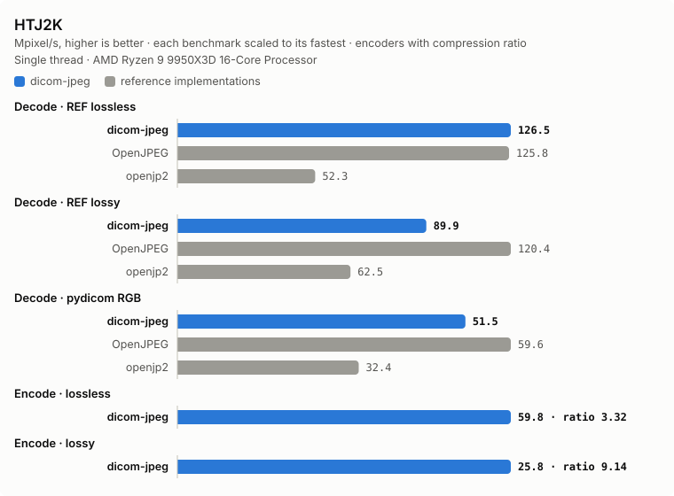

# Benchmark results

Single-threaded throughput on AMD Ryzen 9 9950X3D 16-Core Processor (2026-11-17); dicom-jpeg at the best SIMD level.
Generated by `benchmarks/plot.py` from `cargo bench -p dicom-jpeg-benchmarks`;
see [../README.md](../README.md) for the method and inputs.

## JPEG (T.81)

| Benchmark | Implementation | Mpixel/s | Compression ratio |
|---|---|---|---|
| Decode · JPLL lossless | **dicom-jpeg** | 383.0 |  |
| Decode · JPLL lossless | libjpeg-turbo | 287.8 |  |
| Decode · JPLL lossless | jpeg-decoder | 130.8 |  |
| Decode · JPLY 12-bit | **dicom-jpeg** | 583.2 |  |
| Decode · JPLY 12-bit | libjpeg-turbo | 682.9 |  |
| Decode · REF 8-bit q90 (libjpeg-turbo) | **dicom-jpeg** | 459.8 |  |
| Decode · REF 8-bit q90 (libjpeg-turbo) | libjpeg-turbo | 530.6 |  |
| Decode · REF 8-bit q90 (libjpeg-turbo) | zune-jpeg | 458.2 |  |
| Decode · REF 8-bit q90 (libjpeg-turbo) | jpeg-decoder | 245.1 |  |
| Encode · baseline q90 8-bit | **dicom-jpeg** | 313.1 | 12.71 |
| Encode · baseline q90 8-bit | libjpeg-turbo | 228.2 | 12.71 |
| Encode · extended q90 12-bit | **dicom-jpeg** | 182.8 | 9.10 |
| Encode · extended q90 12-bit | libjpeg-turbo | 139.6 | 9.10 |
| Encode · lossless SV1 | **dicom-jpeg** | 111.5 | 2.96 |
| Encode · lossless SV1 | libjpeg-turbo | 57.2 | 2.96 |

## JPEG-LS (T.87)

| Benchmark | Implementation | Mpixel/s | Compression ratio |
|---|---|---|---|
| Decode · JLSL lossless | **dicom-jpeg** | 76.6 |  |
| Decode · JLSL lossless | CharLS | 118.3 |  |
| Decode · JLSN near-lossless | **dicom-jpeg** | 92.6 |  |
| Decode · JLSN near-lossless | CharLS | 122.2 |  |
| Encode · lossless | **dicom-jpeg** | 53.1 | 3.59 |
| Encode · lossless | CharLS | 73.7 | 3.59 |
| Encode · near 2 | **dicom-jpeg** | 47.1 | 6.34 |
| Encode · near 2 | CharLS | 57.8 | 6.34 |

## JPEG 2000

| Benchmark | Implementation | Mpixel/s | Compression ratio |
|---|---|---|---|
| Decode · J2KI lossy | **dicom-jpeg** | 41.1 |  |
| Decode · J2KI lossy | OpenJPEG | 68.5 |  |
| Decode · J2KI lossy | hayro-jpeg2000 | 63.5 |  |
| Decode · J2KI lossy | openjp2 | 44.4 |  |
| Decode · J2KR lossless | **dicom-jpeg** | 10.8 |  |
| Decode · J2KR lossless | OpenJPEG | 15.4 |  |
| Decode · J2KR lossless | hayro-jpeg2000 | 14.7 |  |
| Decode · J2KR lossless | openjp2 | 12.1 |  |
| Encode · lossless | **dicom-jpeg** | 10.6 | 3.59 |
| Encode · lossless | OpenJPEG | 13.9 | 3.59 |
| Encode · lossless | openjp2 | 12.7 | 3.59 |
| Encode · lossy (rate of dicom-jpeg q90) | **dicom-jpeg** | 15.2 | 10.01 |
| Encode · lossy (rate of dicom-jpeg q90) | OpenJPEG | 14.7 | 10.01 |
| Encode · lossy (rate of dicom-jpeg q90) | openjp2 | 12.3 | 10.01 |

## HTJ2K

| Benchmark | Implementation | Mpixel/s | Compression ratio |
|---|---|---|---|
| Decode · REF lossless | **dicom-jpeg** | 97.9 |  |
| Decode · REF lossless | OpenJPEG | 130.1 |  |
| Decode · REF lossless | openjp2 | 53.6 |  |
| Decode · REF lossy | **dicom-jpeg** | 81.5 |  |
| Decode · REF lossy | OpenJPEG | 124.0 |  |
| Decode · REF lossy | openjp2 | 64.4 |  |
| Decode · pydicom RGB | **dicom-jpeg** | 42.7 |  |
| Decode · pydicom RGB | OpenJPEG | 60.2 |  |
| Decode · pydicom RGB | openjp2 | 33.1 |  |
| Encode · lossless | **dicom-jpeg** | 60.4 | 3.32 |
| Encode · lossy | **dicom-jpeg** | 25.5 | 9.14 |

## JPEG XL

| Benchmark | Implementation | Mpixel/s | Compression ratio |
|---|---|---|---|
| Decode · REF lossless (dicom-jpeg) | **dicom-jpeg** | 25.3 |  |
| Decode · REF lossless (dicom-jpeg) | jxl-rs | 43.1 |  |
| Decode · REF lossless (dicom-jpeg) | libjxl | 33.1 |  |
| Decode · REF lossless (dicom-jpeg) | jxl-oxide | 32.2 |  |
| Decode · REF lossless (libjxl e7) | **dicom-jpeg** | 17.7 |  |
| Decode · REF lossless (libjxl e7) | jxl-rs | 25.1 |  |
| Decode · REF lossless (libjxl e7) | libjxl | 22.5 |  |
| Decode · REF lossless (libjxl e7) | jxl-oxide | 19.9 |  |
| Decode · REF lossy d1 (libjxl e7) | **dicom-jpeg** | 47.9 |  |
| Decode · REF lossy d1 (libjxl e7) | jxl-rs | 156.2 |  |
| Decode · REF lossy d1 (libjxl e7) | libjxl | 137.6 |  |
| Decode · REF lossy d1 (libjxl e7) | jxl-oxide | 38.5 |  |
| Encode · lossless | **dicom-jpeg** | 49.7 | 3.51 |
| Encode · lossless | libjxl e1 | 589.9 | 3.70 |
| Encode · lossless | zune-jpegxl | 147.4 | 3.67 |
| Encode · lossless | libjxl e3 | 27.1 | 4.44 |
| Encode · lossless | libjxl e7 | 4.6 | 5.45 |

## SIMD kernels

| Kernel | Level | Gsamples/s | Speed-up |
|---|---|---|---|
| common/deinterleave3 u16 | scalar | 1.87 | 1.0× |
| common/deinterleave3 u16 | sse41 | 8.57 | 4.6× |
| common/deinterleave3 u16 | avx2 | 8.63 | 4.6× |
| common/deinterleave3 u16 | avx512 | 8.72 | 4.7× |
| common/deinterleave3 u8 | scalar | 3.49 | 1.0× |
| common/deinterleave3 u8 | sse41 | 12.64 | 3.6× |
| common/deinterleave3 u8 | avx2 | 12.62 | 3.6× |
| common/deinterleave3 u8 | avx512 | 12.64 | 3.6× |
| common/interleave3 u16 | scalar | 6.74 | 1.0× |
| common/interleave3 u16 | sse41 | 8.74 | 1.3× |
| common/interleave3 u16 | avx2 | 8.77 | 1.3× |
| common/interleave3 u16 | avx512 | 8.76 | 1.3× |
| common/interleave3 u8 | scalar | 3.50 | 1.0× |
| common/interleave3 u8 | sse41 | 11.64 | 3.3× |
| common/interleave3 u8 | avx2 | 11.57 | 3.3× |
| common/interleave3 u8 | avx512 | 11.68 | 3.3× |
| jpeg/downsample h2v1 | scalar | 15.06 | 1.0× |
| jpeg/downsample h2v1 | sse41 | 27.61 | 1.8× |
| jpeg/downsample h2v1 | avx2 | 57.18 | 3.8× |
| jpeg/downsample h2v1 | avx512 | 88.26 | 5.9× |
| jpeg/downsample h2v2 | scalar | 22.12 | 1.0× |
| jpeg/downsample h2v2 | sse41 | 38.83 | 1.8× |
| jpeg/downsample h2v2 | avx2 | 73.22 | 3.3× |
| jpeg/downsample h2v2 | avx512 | 89.22 | 4.0× |
| jpeg/fdct+quantize | scalar | 0.34 | 1.0× |
| jpeg/fdct+quantize | sse41 | 2.30 | 6.8× |
| jpeg/fdct+quantize | avx2 | 3.60 | 10.6× |
| jpeg/fdct+quantize | avx512 | 6.36 | 18.7× |
| jpeg/idct | scalar | 1.00 | 1.0× |
| jpeg/idct | sse41 | 2.72 | 2.7× |
| jpeg/idct | avx2 | 4.14 | 4.1× |
| jpeg/idct | avx512 | 7.80 | 7.8× |
| jpeg/rgb->ycbcr | scalar | 1.74 | 1.0× |
| jpeg/rgb->ycbcr | sse41 | 2.97 | 1.7× |
| jpeg/rgb->ycbcr | avx2 | 5.23 | 3.0× |
| jpeg/rgb->ycbcr | avx512 | 11.06 | 6.4× |
| jpeg/upsample h2v1 | scalar | 8.60 | 1.0× |
| jpeg/upsample h2v1 | sse41 | 16.62 | 1.9× |
| jpeg/upsample h2v1 | avx2 | 32.09 | 3.7× |
| jpeg/upsample h2v1 | avx512 | 46.58 | 5.4× |
| jpeg/upsample h2v2 | scalar | 4.97 | 1.0× |
| jpeg/upsample h2v2 | sse41 | 10.27 | 2.1× |
| jpeg/upsample h2v2 | avx2 | 19.24 | 3.9× |
| jpeg/upsample h2v2 | avx512 | 25.53 | 5.1× |
| jpeg/ycbcr->rgb | scalar | 1.04 | 1.0× |
| jpeg/ycbcr->rgb | sse41 | 2.80 | 2.7× |
| jpeg/ycbcr->rgb | avx2 | 5.06 | 4.9× |
| jpeg/ycbcr->rgb | avx512 | 9.03 | 8.7× |
