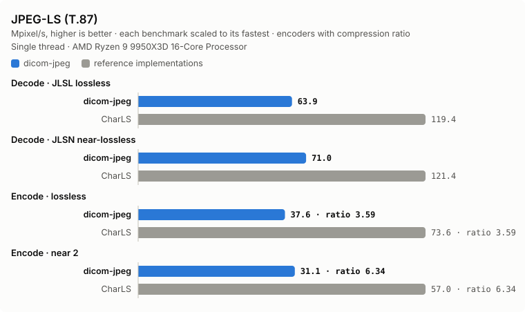

# Benchmark results

Single-threaded throughput on AMD Ryzen 9 9950X3D 16-Core Processor (2026-11-18); dicom-jpeg at the best SIMD level.
Generated by `benchmarks/plot.py` from `cargo bench -p dicom-jpeg-benchmarks`;
see [../README.md](../README.md) for the method and inputs.

## JPEG (T.81)

| Benchmark | Implementation | Mpixel/s | Compression ratio |
|---|---|---|---|
| Decode · JPLL lossless | **dicom-jpeg** | 400.4 |  |
| Decode · JPLL lossless | libjpeg-turbo | 286.9 |  |
| Decode · JPLL lossless | jpeg-decoder | 127.8 |  |
| Decode · JPLY 12-bit | **dicom-jpeg** | 991.2 |  |
| Decode · JPLY 12-bit | libjpeg-turbo | 691.4 |  |
| Decode · REF 8-bit q90 (libjpeg-turbo) | **dicom-jpeg** | 461.4 |  |
| Decode · REF 8-bit q90 (libjpeg-turbo) | libjpeg-turbo | 533.7 |  |
| Decode · REF 8-bit q90 (libjpeg-turbo) | zune-jpeg | 462.5 |  |
| Decode · REF 8-bit q90 (libjpeg-turbo) | jpeg-decoder | 261.7 |  |
| Encode · baseline q90 8-bit | **dicom-jpeg** | 318.1 | 12.71 |
| Encode · baseline q90 8-bit | libjpeg-turbo | 228.7 | 12.71 |
| Encode · extended q90 12-bit | **dicom-jpeg** | 397.6 | 9.10 |
| Encode · extended q90 12-bit | libjpeg-turbo | 139.0 | 9.10 |
| Encode · lossless SV1 | **dicom-jpeg** | 109.8 | 2.96 |
| Encode · lossless SV1 | libjpeg-turbo | 58.2 | 2.96 |

## JPEG-LS (T.87)

| Benchmark | Implementation | Mpixel/s | Compression ratio |
|---|---|---|---|
| Decode · JLSL lossless | **dicom-jpeg** | 80.2 |  |
| Decode · JLSL lossless | CharLS | 118.6 |  |
| Decode · JLSN near-lossless | **dicom-jpeg** | 93.6 |  |
| Decode · JLSN near-lossless | CharLS | 122.7 |  |
| Encode · lossless | **dicom-jpeg** | 52.7 | 3.59 |
| Encode · lossless | CharLS | 74.0 | 3.59 |
| Encode · near 2 | **dicom-jpeg** | 47.0 | 6.34 |
| Encode · near 2 | CharLS | 58.0 | 6.34 |

## JPEG 2000

| Benchmark | Implementation | Mpixel/s | Compression ratio |
|---|---|---|---|
| Decode · J2KI lossy | **dicom-jpeg** | 52.2 |  |
| Decode · J2KI lossy | OpenJPEG | 68.2 |  |
| Decode · J2KI lossy | hayro-jpeg2000 | 65.6 |  |
| Decode · J2KI lossy | openjp2 | 44.1 |  |
| Decode · J2KR lossless | **dicom-jpeg** | 11.3 |  |
| Decode · J2KR lossless | OpenJPEG | 15.2 |  |
| Decode · J2KR lossless | hayro-jpeg2000 | 14.6 |  |
| Decode · J2KR lossless | openjp2 | 12.0 |  |
| Encode · lossless | **dicom-jpeg** | 10.7 | 3.59 |
| Encode · lossless | OpenJPEG | 14.2 | 3.59 |
| Encode · lossless | openjp2 | 12.6 | 3.59 |
| Encode · lossy (rate of dicom-jpeg q90) | **dicom-jpeg** | 15.5 | 10.01 |
| Encode · lossy (rate of dicom-jpeg q90) | OpenJPEG | 14.9 | 10.01 |
| Encode · lossy (rate of dicom-jpeg q90) | openjp2 | 12.3 | 10.01 |

## HTJ2K

| Benchmark | Implementation | Mpixel/s | Compression ratio |
|---|---|---|---|
| Decode · REF lossless | **dicom-jpeg** | 135.6 |  |
| Decode · REF lossless | OpenJPEG | 132.4 |  |
| Decode · REF lossless | openjp2 | 54.4 |  |
| Decode · REF lossy | **dicom-jpeg** | 137.5 |  |
| Decode · REF lossy | OpenJPEG | 121.7 |  |
| Decode · REF lossy | openjp2 | 65.0 |  |
| Decode · pydicom RGB | **dicom-jpeg** | 62.5 |  |
| Decode · pydicom RGB | OpenJPEG | 59.8 |  |
| Decode · pydicom RGB | openjp2 | 33.0 |  |
| Encode · lossless | **dicom-jpeg** | 61.1 | 3.32 |
| Encode · lossy | **dicom-jpeg** | 26.3 | 9.14 |

## JPEG XL

| Benchmark | Implementation | Mpixel/s | Compression ratio |
|---|---|---|---|
| Decode · REF lossless (dicom-jpeg) | **dicom-jpeg** | 24.1 |  |
| Decode · REF lossless (dicom-jpeg) | jxl-rs | 42.8 |  |
| Decode · REF lossless (dicom-jpeg) | libjxl | 32.8 |  |
| Decode · REF lossless (dicom-jpeg) | jxl-oxide | 31.8 |  |
| Decode · REF lossless (libjxl e7) | **dicom-jpeg** | 17.8 |  |
| Decode · REF lossless (libjxl e7) | jxl-rs | 24.8 |  |
| Decode · REF lossless (libjxl e7) | libjxl | 22.5 |  |
| Decode · REF lossless (libjxl e7) | jxl-oxide | 19.7 |  |
| Decode · REF lossy d1 (libjxl e7) | **dicom-jpeg** | 71.2 |  |
| Decode · REF lossy d1 (libjxl e7) | jxl-rs | 154.1 |  |
| Decode · REF lossy d1 (libjxl e7) | libjxl | 135.5 |  |
| Decode · REF lossy d1 (libjxl e7) | jxl-oxide | 37.9 |  |
| Encode · lossless | **dicom-jpeg** | 57.4 | 3.51 |
| Encode · lossless | libjxl e1 | 591.2 | 3.70 |
| Encode · lossless | zune-jpegxl | 146.2 | 3.67 |
| Encode · lossless | libjxl e3 | 26.8 | 4.44 |
| Encode · lossless | libjxl e7 | 4.5 | 5.45 |

## SIMD kernels

| Kernel | Level | Gsamples/s | Speed-up |
|---|---|---|---|
| common/deinterleave3 u16 | scalar | 1.86 | 1.0× |
| common/deinterleave3 u16 | sse41 | 8.69 | 4.7× |
| common/deinterleave3 u16 | avx2 | 8.65 | 4.6× |
| common/deinterleave3 u16 | avx512 | 8.70 | 4.7× |
| common/deinterleave3 u8 | scalar | 2.75 | 1.0× |
| common/deinterleave3 u8 | sse41 | 12.57 | 4.6× |
| common/deinterleave3 u8 | avx2 | 12.55 | 4.6× |
| common/deinterleave3 u8 | avx512 | 12.55 | 4.6× |
| common/interleave3 u16 | scalar | 6.71 | 1.0× |
| common/interleave3 u16 | sse41 | 8.74 | 1.3× |
| common/interleave3 u16 | avx2 | 8.74 | 1.3× |
| common/interleave3 u16 | avx512 | 8.74 | 1.3× |
| common/interleave3 u8 | scalar | 3.50 | 1.0× |
| common/interleave3 u8 | sse41 | 11.71 | 3.3× |
| common/interleave3 u8 | avx2 | 11.70 | 3.3× |
| common/interleave3 u8 | avx512 | 11.64 | 3.3× |
| j2k/dwt apredict53 | scalar | 12.38 | 1.0× |
| j2k/dwt apredict53 | sse41 | 13.30 | 1.1× |
| j2k/dwt apredict53 | avx2 | 20.02 | 1.6× |
| j2k/dwt apredict53 | avx512 | 25.15 | 2.0× |
| j2k/dwt aupdate53 | scalar | 12.42 | 1.0× |
| j2k/dwt aupdate53 | sse41 | 13.23 | 1.1× |
| j2k/dwt aupdate53 | avx2 | 19.42 | 1.6× |
| j2k/dwt aupdate53 | avx512 | 23.64 | 1.9× |
| j2k/dwt lift97 | scalar | 12.34 | 1.0× |
| j2k/dwt lift97 | sse41 | 10.88 | 0.9× |
| j2k/dwt lift97 | avx2 | 17.78 | 1.4× |
| j2k/dwt lift97 | avx512 | 22.04 | 1.8× |
| j2k/dwt predict53 | scalar | 12.38 | 1.0× |
| j2k/dwt predict53 | sse41 | 13.35 | 1.1× |
| j2k/dwt predict53 | avx2 | 20.16 | 1.6× |
| j2k/dwt predict53 | avx512 | 23.10 | 1.9× |
| j2k/dwt scale97 | scalar | 27.87 | 1.0× |
| j2k/dwt scale97 | sse41 | 34.02 | 1.2× |
| j2k/dwt scale97 | avx2 | 59.14 | 2.1× |
| j2k/dwt scale97 | avx512 | 61.20 | 2.2× |
| j2k/dwt update53 | scalar | 12.35 | 1.0× |
| j2k/dwt update53 | sse41 | 13.23 | 1.1× |
| j2k/dwt update53 | avx2 | 19.57 | 1.6× |
| j2k/dwt update53 | avx512 | 23.60 | 1.9× |
| j2k/level shift float | scalar | 0.98 | 1.0× |
| j2k/level shift float | sse41 | 5.03 | 5.1× |
| j2k/level shift float | avx2 | 9.91 | 10.1× |
| j2k/level shift float | avx512 | 13.89 | 14.2× |
| j2k/level shift int | scalar | 6.62 | 1.0× |
| j2k/level shift int | sse41 | 12.80 | 1.9× |
| j2k/level shift int | avx2 | 15.23 | 2.3× |
| j2k/level shift int | avx512 | 18.63 | 2.8× |
| jpeg/downsample h2v1 | scalar | 14.92 | 1.0× |
| jpeg/downsample h2v1 | sse41 | 28.43 | 1.9× |
| jpeg/downsample h2v1 | avx2 | 57.22 | 3.8× |
| jpeg/downsample h2v1 | avx512 | 87.64 | 5.9× |
| jpeg/downsample h2v2 | scalar | 21.57 | 1.0× |
| jpeg/downsample h2v2 | sse41 | 41.49 | 1.9× |
| jpeg/downsample h2v2 | avx2 | 73.08 | 3.4× |
| jpeg/downsample h2v2 | avx512 | 87.57 | 4.1× |
| jpeg/fdct+quantize | scalar | 0.33 | 1.0× |
| jpeg/fdct+quantize | sse41 | 2.29 | 7.0× |
| jpeg/fdct+quantize | avx2 | 3.57 | 10.9× |
| jpeg/fdct+quantize | avx512 | 6.32 | 19.3× |
| jpeg/fdct+quantize 12-bit | scalar | 0.32 | 1.0× |
| jpeg/fdct+quantize 12-bit | sse41 | 0.32 | 1.0× |
| jpeg/fdct+quantize 12-bit | avx2 | 0.32 | 1.0× |
| jpeg/fdct+quantize 12-bit | avx512 | 3.07 | 9.7× |
| jpeg/idct | scalar | 1.03 | 1.0× |
| jpeg/idct | sse41 | 2.72 | 2.6× |
| jpeg/idct | avx2 | 4.17 | 4.0× |
| jpeg/idct | avx512 | 7.74 | 7.5× |
| jpeg/idct 12-bit | scalar | 0.98 | 1.0× |
| jpeg/idct 12-bit | sse41 | 0.97 | 1.0× |
| jpeg/idct 12-bit | avx2 | 0.98 | 1.0× |
| jpeg/idct 12-bit | avx512 | 3.60 | 3.7× |
| jpeg/rgb->ycbcr | scalar | 1.73 | 1.0× |
| jpeg/rgb->ycbcr | sse41 | 2.92 | 1.7× |
| jpeg/rgb->ycbcr | avx2 | 5.19 | 3.0× |
| jpeg/rgb->ycbcr | avx512 | 10.66 | 6.2× |
| jpeg/upsample h2v1 | scalar | 8.32 | 1.0× |
| jpeg/upsample h2v1 | sse41 | 16.60 | 2.0× |
| jpeg/upsample h2v1 | avx2 | 30.72 | 3.7× |
| jpeg/upsample h2v1 | avx512 | 42.49 | 5.1× |
| jpeg/upsample h2v2 | scalar | 4.96 | 1.0× |
| jpeg/upsample h2v2 | sse41 | 9.94 | 2.0× |
| jpeg/upsample h2v2 | avx2 | 18.37 | 3.7× |
| jpeg/upsample h2v2 | avx512 | 24.11 | 4.9× |
| jpeg/ycbcr->rgb | scalar | 1.03 | 1.0× |
| jpeg/ycbcr->rgb | sse41 | 2.77 | 2.7× |
| jpeg/ycbcr->rgb | avx2 | 5.07 | 4.9× |
| jpeg/ycbcr->rgb | avx512 | 9.14 | 8.9× |
| jxl/epf step 0 | scalar | 0.06 | 1.0× |
| jxl/epf step 0 | sse41 | 0.08 | 1.2× |
| jxl/epf step 0 | avx2 | 0.15 | 2.3× |
| jxl/epf step 0 | avx512 | 0.15 | 2.3× |
| jxl/epf step 1 | scalar | 0.11 | 1.0× |
| jxl/epf step 1 | sse41 | 0.20 | 1.8× |
| jxl/epf step 1 | avx2 | 0.38 | 3.5× |
| jxl/epf step 1 | avx512 | 0.38 | 3.5× |
| jxl/epf step 2 | scalar | 0.19 | 1.0× |
| jxl/epf step 2 | sse41 | 0.50 | 2.7× |
| jxl/epf step 2 | avx2 | 0.87 | 4.7× |
| jxl/epf step 2 | avx512 | 0.88 | 4.8× |
| jxl/gaborish | scalar | 4.08 | 1.0× |
| jxl/gaborish | sse41 | 4.08 | 1.0× |
| jxl/gaborish | avx2 | 6.79 | 1.7× |
| jxl/gaborish | avx512 | 9.58 | 2.3× |
| jxl/idct 32x32 | scalar | 0.62 | 1.0× |
| jxl/idct 32x32 | sse41 | 1.50 | 2.4× |
| jxl/idct 32x32 | avx2 | 2.32 | 3.7× |
| jxl/idct 32x32 | avx512 | 2.43 | 3.9× |
| jxl/idct 8x8 | scalar | 0.54 | 1.0× |
| jxl/idct 8x8 | sse41 | 2.56 | 4.7× |
| jxl/idct 8x8 | avx2 | 2.76 | 5.1× |
| jxl/idct 8x8 | avx512 | 2.79 | 5.2× |
| jxl/xyb->linear | scalar | 1.51 | 1.0× |
| jxl/xyb->linear | sse41 | 1.57 | 1.0× |
| jxl/xyb->linear | avx2 | 2.56 | 1.7× |
| jxl/xyb->linear | avx512 | 3.55 | 2.4× |
