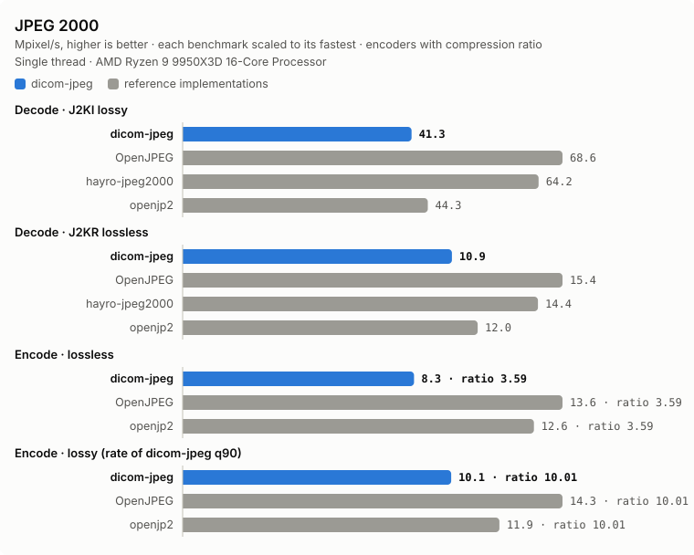
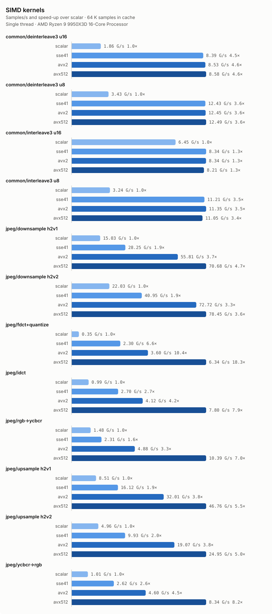

# Benchmark results

Single-threaded throughput on AMD Ryzen 9 9950X3D 16-Core Processor (2026-11-17); dicom-jpeg at the best SIMD level.
Generated by `benchmarks/plot.py` from `cargo bench -p dicom-jpeg-benchmarks`;
see [../README.md](../README.md) for the method and inputs.

## JPEG (T.81)

| Benchmark | Implementation | Mpixel/s | Compression ratio |
|---|---|---|---|
| Decode · JPLL lossless | **dicom-jpeg** | 380.9 |  |
| Decode · JPLL lossless | libjpeg-turbo | 285.9 |  |
| Decode · JPLL lossless | jpeg-decoder | 129.6 |  |
| Decode · JPLY 12-bit | **dicom-jpeg** | 997.4 |  |
| Decode · JPLY 12-bit | libjpeg-turbo | 674.4 |  |
| Decode · REF 8-bit q90 (libjpeg-turbo) | **dicom-jpeg** | 459.5 |  |
| Decode · REF 8-bit q90 (libjpeg-turbo) | libjpeg-turbo | 539.5 |  |
| Decode · REF 8-bit q90 (libjpeg-turbo) | zune-jpeg | 460.7 |  |
| Decode · REF 8-bit q90 (libjpeg-turbo) | jpeg-decoder | 261.8 |  |
| Encode · baseline q90 8-bit | **dicom-jpeg** | 311.5 | 12.71 |
| Encode · baseline q90 8-bit | libjpeg-turbo | 228.3 | 12.71 |
| Encode · extended q90 12-bit | **dicom-jpeg** | 391.0 | 9.10 |
| Encode · extended q90 12-bit | libjpeg-turbo | 136.6 | 9.10 |
| Encode · lossless SV1 | **dicom-jpeg** | 111.4 | 2.96 |
| Encode · lossless SV1 | libjpeg-turbo | 58.5 | 2.96 |

## JPEG-LS (T.87)

| Benchmark | Implementation | Mpixel/s | Compression ratio |
|---|---|---|---|
| Decode · JLSL lossless | **dicom-jpeg** | 78.8 |  |
| Decode · JLSL lossless | CharLS | 120.0 |  |
| Decode · JLSN near-lossless | **dicom-jpeg** | 93.0 |  |
| Decode · JLSN near-lossless | CharLS | 124.3 |  |
| Encode · lossless | **dicom-jpeg** | 52.5 | 3.59 |
| Encode · lossless | CharLS | 73.3 | 3.59 |
| Encode · near 2 | **dicom-jpeg** | 46.4 | 6.34 |
| Encode · near 2 | CharLS | 58.2 | 6.34 |

## JPEG 2000

| Benchmark | Implementation | Mpixel/s | Compression ratio |
|---|---|---|---|
| Decode · J2KI lossy | **dicom-jpeg** | 43.9 |  |
| Decode · J2KI lossy | OpenJPEG | 67.0 |  |
| Decode · J2KI lossy | hayro-jpeg2000 | 64.4 |  |
| Decode · J2KI lossy | openjp2 | 43.9 |  |
| Decode · J2KR lossless | **dicom-jpeg** | 11.1 |  |
| Decode · J2KR lossless | OpenJPEG | 15.4 |  |
| Decode · J2KR lossless | hayro-jpeg2000 | 14.6 |  |
| Decode · J2KR lossless | openjp2 | 11.9 |  |
| Encode · lossless | **dicom-jpeg** | 10.8 | 3.59 |
| Encode · lossless | OpenJPEG | 14.1 | 3.59 |
| Encode · lossless | openjp2 | 12.5 | 3.59 |
| Encode · lossy (rate of dicom-jpeg q90) | **dicom-jpeg** | 15.6 | 10.01 |
| Encode · lossy (rate of dicom-jpeg q90) | OpenJPEG | 14.9 | 10.01 |
| Encode · lossy (rate of dicom-jpeg q90) | openjp2 | 12.2 | 10.01 |

## HTJ2K

| Benchmark | Implementation | Mpixel/s | Compression ratio |
|---|---|---|---|
| Decode · REF lossless | **dicom-jpeg** | 131.0 |  |
| Decode · REF lossless | OpenJPEG | 132.2 |  |
| Decode · REF lossless | openjp2 | 54.4 |  |
| Decode · REF lossy | **dicom-jpeg** | 92.7 |  |
| Decode · REF lossy | OpenJPEG | 123.9 |  |
| Decode · REF lossy | openjp2 | 64.4 |  |
| Decode · pydicom RGB | **dicom-jpeg** | 51.7 |  |
| Decode · pydicom RGB | OpenJPEG | 60.0 |  |
| Decode · pydicom RGB | openjp2 | 32.9 |  |
| Encode · lossless | **dicom-jpeg** | 60.9 | 3.32 |
| Encode · lossy | **dicom-jpeg** | 25.9 | 9.14 |

## JPEG XL

| Benchmark | Implementation | Mpixel/s | Compression ratio |
|---|---|---|---|
| Decode · REF lossless (dicom-jpeg) | **dicom-jpeg** | 24.7 |  |
| Decode · REF lossless (dicom-jpeg) | jxl-rs | 43.1 |  |
| Decode · REF lossless (dicom-jpeg) | libjxl | 33.0 |  |
| Decode · REF lossless (dicom-jpeg) | jxl-oxide | 32.1 |  |
| Decode · REF lossless (libjxl e7) | **dicom-jpeg** | 17.9 |  |
| Decode · REF lossless (libjxl e7) | jxl-rs | 24.9 |  |
| Decode · REF lossless (libjxl e7) | libjxl | 22.6 |  |
| Decode · REF lossless (libjxl e7) | jxl-oxide | 20.0 |  |
| Decode · REF lossy d1 (libjxl e7) | **dicom-jpeg** | 46.9 |  |
| Decode · REF lossy d1 (libjxl e7) | jxl-rs | 153.8 |  |
| Decode · REF lossy d1 (libjxl e7) | libjxl | 137.2 |  |
| Decode · REF lossy d1 (libjxl e7) | jxl-oxide | 38.6 |  |
| Encode · lossless | **dicom-jpeg** | 57.0 | 3.51 |
| Encode · lossless | libjxl e1 | 585.3 | 3.70 |
| Encode · lossless | zune-jpegxl | 144.1 | 3.67 |
| Encode · lossless | libjxl e3 | 26.7 | 4.44 |
| Encode · lossless | libjxl e7 | 4.5 | 5.45 |

## SIMD kernels

| Kernel | Level | Gsamples/s | Speed-up |
|---|---|---|---|
| common/deinterleave3 u16 | scalar | 1.88 | 1.0× |
| common/deinterleave3 u16 | sse41 | 8.42 | 4.5× |
| common/deinterleave3 u16 | avx2 | 8.49 | 4.5× |
| common/deinterleave3 u16 | avx512 | 7.89 | 4.2× |
| common/deinterleave3 u8 | scalar | 3.43 | 1.0× |
| common/deinterleave3 u8 | sse41 | 12.43 | 3.6× |
| common/deinterleave3 u8 | avx2 | 12.61 | 3.7× |
| common/deinterleave3 u8 | avx512 | 12.57 | 3.7× |
| common/interleave3 u16 | scalar | 6.72 | 1.0× |
| common/interleave3 u16 | sse41 | 8.66 | 1.3× |
| common/interleave3 u16 | avx2 | 8.69 | 1.3× |
| common/interleave3 u16 | avx512 | 8.70 | 1.3× |
| common/interleave3 u8 | scalar | 3.49 | 1.0× |
| common/interleave3 u8 | sse41 | 11.71 | 3.4× |
| common/interleave3 u8 | avx2 | 11.66 | 3.3× |
| common/interleave3 u8 | avx512 | 11.67 | 3.3× |
| jpeg/downsample h2v1 | scalar | 15.02 | 1.0× |
| jpeg/downsample h2v1 | sse41 | 28.26 | 1.9× |
| jpeg/downsample h2v1 | avx2 | 55.18 | 3.7× |
| jpeg/downsample h2v1 | avx512 | 72.32 | 4.8× |
| jpeg/downsample h2v2 | scalar | 21.57 | 1.0× |
| jpeg/downsample h2v2 | sse41 | 41.34 | 1.9× |
| jpeg/downsample h2v2 | avx2 | 68.29 | 3.2× |
| jpeg/downsample h2v2 | avx512 | 79.35 | 3.7× |
| jpeg/fdct+quantize | scalar | 0.35 | 1.0× |
| jpeg/fdct+quantize | sse41 | 2.28 | 6.6× |
| jpeg/fdct+quantize | avx2 | 3.57 | 10.3× |
| jpeg/fdct+quantize | avx512 | 6.34 | 18.3× |
| jpeg/idct | scalar | 1.00 | 1.0× |
| jpeg/idct | sse41 | 2.72 | 2.7× |
| jpeg/idct | avx2 | 4.12 | 4.1× |
| jpeg/idct | avx512 | 7.75 | 7.8× |
| jpeg/rgb->ycbcr | scalar | 1.72 | 1.0× |
| jpeg/rgb->ycbcr | sse41 | 2.91 | 1.7× |
| jpeg/rgb->ycbcr | avx2 | 5.09 | 3.0× |
| jpeg/rgb->ycbcr | avx512 | 10.85 | 6.3× |
| jpeg/upsample h2v1 | scalar | 8.31 | 1.0× |
| jpeg/upsample h2v1 | sse41 | 16.11 | 1.9× |
| jpeg/upsample h2v1 | avx2 | 30.17 | 3.6× |
| jpeg/upsample h2v1 | avx512 | 43.25 | 5.2× |
| jpeg/upsample h2v2 | scalar | 4.97 | 1.0× |
| jpeg/upsample h2v2 | sse41 | 9.97 | 2.0× |
| jpeg/upsample h2v2 | avx2 | 18.26 | 3.7× |
| jpeg/upsample h2v2 | avx512 | 23.69 | 4.8× |
| jpeg/ycbcr->rgb | scalar | 1.03 | 1.0× |
| jpeg/ycbcr->rgb | sse41 | 2.74 | 2.7× |
| jpeg/ycbcr->rgb | avx2 | 5.12 | 5.0× |
| jpeg/ycbcr->rgb | avx512 | 9.20 | 8.9× |
